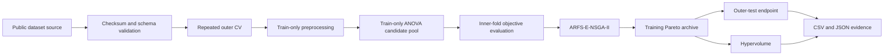

# ARFS-E-NSGA-II

[](https://github.com/kaiju123456x-gif/ARFS-E-NSGA-II/actions/workflows/ci.yml)

Official reproducibility repository for **Adaptive Redundancy-Aware Feature Selection with Enhanced Evolutionary Search Based on NSGA-II**.

This repository keeps the implementation, experiment configurations, public-data access workflow, provenance checks, tests, and result-audit tools in one location. It supports independent verification of the proposed ARFS-E-NSGA-II method and its eight component combinations.

## Repository contents

| Path | Purpose |
|---|---|
| `src/arfs_ensga2/` | ARFS-E-NSGA-II, objectives, initialization, nested evaluation, data preparation, and auditing |
| `configs/` | Exact paper and smoke-test configurations |
| `data/` | Dataset inventory, stable source identifiers, checksums, and automated preparation instructions |
| `tests/` | Unit and integration tests |
| `.github/workflows/ci.yml` | Automated tests and an end-to-end reproducibility smoke run |
| `REPRODUCIBILITY.md` | Clean-environment protocol for reproducing the experiments |
| `PAPER_REPRODUCIBILITY.md` | Direct map from manuscript claims to code, commands, and evidence |
| `paper/` | Machine-readable Table I identities, experimental contract, and reported aggregate targets |
| `CONTRIBUTING.md` | English-language, portability, testing, and data-handling requirements |
| `CITATION.cff` | Machine-readable software citation metadata |
| `requirements-py38-lock.txt` | Locked dependencies for the manuscript's Python 3.8 runtime |
| `COMPARATOR_PROVENANCE.md` | Legacy-source hashes, adaptation boundary, and HMO integrity finding |

Raw third-party files are not relicensed by this repository. The data commands retrieve the fixed public sources, validate their identities, and generate the analysis-ready matrices locally. See [`data/README.md`](data/README.md) and [`data/dataset_manifest.csv`](data/dataset_manifest.csv).

The manuscript-to-repository dataset mapping is recorded separately in [`paper/dataset_table.csv`](paper/dataset_table.csv). It distinguishes manuscript GEO accessions from mirror-specific retrieval identifiers, so `GSE15471`/`E-GEOD-15471` and `GSE10072`/`E-GEOD-10072` cannot be mistaken for different datasets.

## Method coverage



- Three objectives: inner-CV balanced error, selected-feature ratio, and mean pairwise mutual-information redundancy.
- Multi-source initialization using ReliefF, mutual information, chi-square, F-score, and random-forest importance.
- Dynamic Partitioning and IGD-Adaptive Mutation (DPIM).
- DPIM-guided Redundancy-aware Feature Modeling (DRFM).
- Eight component combinations: `none`, `a`, `b`, `c`, `ab`, `ac`, `bc`, and `abc`.
- Audited comparator cores for MOPSO, NSGA-III, FTGGA, MMODE, MOMOGS-PCE,
  XGBoost-MOGA, HSIC Lasso, and Block HSIC Lasso, plus a paper-guided
  HMO-NSGA-II reimplementation.
- Repeated nested stratified CV, with group-aware splitting for linked biological samples.
- Exact three-dimensional hypervolume with reference point `(1.1, 1.1, 1.1)`.
- Machine-readable folds, candidate sets, seeds, diagnostics, Pareto archives, checksums, and environment metadata.

### What population size 12 means

Population size is the number of candidate feature subsets maintained by an
evolutionary optimizer; it is **not** the number of biological samples used.
With the paper configuration, each individual is a 30-bit mask over the
training-fold candidate pool. Every mask is evaluated using all samples in the
outer-training fold through three-fold inner cross-validation.

| Quantity | Paper value | Meaning |
|---|---:|---|
| Candidate features | 30 | Length of each binary feature-selection mask |
| Population size | 12 | Candidate masks maintained in one generation |
| Evaluation budget | 240 | Total objective calls per evolutionary run |
| Training samples | Dataset/fold dependent | All outer-training samples participate in inner-CV evaluation |

## Five-minute verification

Python 3.10 or 3.11 is recommended.

```bash
python -m pip install -r requirements-lock.txt
python -m pip install -e . --no-deps
python -m pytest
python -m arfs_ensga2.cli demo --output results/demo
python -m arfs_ensga2.cli audit --output results/demo
```

The final two commands execute and audit a deterministic end-to-end smoke experiment. A successful audit prints `"status": "PASS"`.

The manuscript reports Python 3.8. For that interpreter, install `requirements-py38-lock.txt` instead. Continuous integration tests Python 3.8, 3.10, and 3.11.

## Obtain the ten paper datasets

```bash
python -m arfs_ensga2.cli prepare-data
```

This command retrieves the fixed GEO, ArrayExpress, Mendeley Data, or commit-pinned source; validates source and processed checksums, dimensions, and class counts; preserves verified patient groups; and writes an analysis-ready matrix plus a portable provenance manifest for every dataset. It exits with an error if any generated matrix differs from the hash in the public manifest.

The source identifiers and expected processed-file hashes are recorded in [`data/dataset_manifest.csv`](data/dataset_manifest.csv). No row-order inference is used to create biological groups.

## Reproduce the proposed method

From a clean clone, one command retrieves and verifies all data, runs the proposed method on all ten datasets, and audits every result directory:

```bash
python -m arfs_ensga2.cli reproduce
```

Use `--skip-data` to reuse already verified matrices. Add `--ablation` to run all eight component combinations.

The equivalent experiment-only command is:

```bash
python -m arfs_ensga2.cli suite --data-dir data/processed --output results/paper
```

Reproduce the paper's eight-pattern ablation on Colon and SRBCT:

```bash
python -m arfs_ensga2.cli paper-ablation
```

The broader `suite --ablation` command remains available for an additional, non-paper ablation across all ten datasets.

Reproduce the paper's one-factor and two-factor parameter analysis on Colon and SRBCT:

```bash
python -m arfs_ensga2.cli paper-parameters
```

This writes a machine-readable `parameter_analysis_summary.csv` plus the complete fold-level evidence for every setting.

The suite automatically uses `configs/grouped.yaml` for `Breast_cancer_2`, `Pancreatic_Cancer`, and `Lung_Adenocarcinoma`, and `configs/default.yaml` for the other datasets. Each dataset directory is audited before the command returns successfully.

For a single dataset:

```bash
python -m arfs_ensga2.cli run --data data/processed/Colon.csv.gz --config configs/default.yaml --variant abc --output results/colon-abc
python -m arfs_ensga2.cli ablation --data data/processed/Colon.csv.gz --config configs/default.yaml --output results/colon-ablation
```

Run the proposed method, common NSGA-II backbone, and every available audited
comparator on exactly the same folds and candidate pools:

```bash
python -m arfs_ensga2.cli compare --data data/processed/Colon.csv.gz --config configs/default.yaml --output results/colon-comparison
```

Repeat `--method` to select a subset. The HMO-NSGA-II entry is reconstructed
from Vijai and P. (2025), not from the unrelated RMODE-E file in the legacy
snapshot. Paper-specified components and fair-protocol completions are separated
in [`COMPARATOR_PROVENANCE.md`](COMPARATOR_PROVENANCE.md).

Run the complete manuscript method set on all ten verified datasets:

```bash
python -m arfs_ensga2.cli paper-comparison
```

Full repeated nested-CV runs are computationally expensive. Runtime depends on hardware and the number of variants; no reduced settings are silently substituted.

## Paper-reported reference values

The manuscript reports a mean hypervolume of `1.2830` (mean rank `1.30`), `3.43` selected features on average, mean redundancy `0.2213`, and mean end-to-end runtime `14.23` seconds for ARFS-E-NSGA-II. These are comparison targets, not pre-generated run evidence. Their provenance and interpretation limits are recorded in [`paper/reported_results.yaml`](paper/reported_results.yaml); fresh fold-level evidence is produced under `results/` by the commands above.

## Output contract

| File | Reproducibility evidence |
|---|---|
| `fold_results.csv` | Outer-test metrics, endpoint subset, seed, runtime, and evaluation count |
| `archives.csv` | Complete training-side nondominated archives |
| `summary.csv` | Mean and sample standard deviation across outer folds |
| `splits.json` | Outer/inner indices and training-only ANOVA candidate sets |
| `manifest.json` | Input checksum, class counts, missingness, configuration, and environment |
| `diagnostics/*.json` | IGD trace, DPIM state, DRFM swaps, and feature monitoring |
| `audit_report.json` | Machine-readable integrity verdict |

## Exact implementation decisions

| Item | Implemented decision |
|---|---|
| Feature-ratio denominator | The 30-feature training-fold candidate pool |
| Sparsity-biased mutation | Remove a selected bit on a mutation event; add an unselected bit with probability 0.25 |
| Initialization validation subset | Top 10 features per source |
| Ties | Stable order followed by the smallest feature index |
| RED estimator | Seeded `sklearn.feature_selection.mutual_info_regression` with an on-demand symmetric cache |
| Linked samples | The same group identifier is excluded across both outer and inner folds |

Every run stores these settings and its input checksum in `manifest.json`.
The result tables retain the machine-facing `variant` identifier and also add
the manuscript-facing `method` label, preventing identifiers such as `abc` and
`none` from being mistaken for method names.

## Scope of the release

This repository implements the proposed method, the common NSGA-II backbone,
all eight proposed-component combinations, eight audited comparator cores, one
paper-guided comparator reimplementation, the complete data preparation
workflow, and the matched nested evaluation protocol.
The legacy comparator adaptations and the HMO-NSGA-II reconstruction are not
represented as original-author reference implementations.

## Continuous verification

GitHub Actions runs under Python 3.8, 3.10, and 3.11. It installs the corresponding locked environment, executes all tests, runs a deterministic end-to-end experiment, and independently audits the generated evidence. The test suite also checks public text files for Chinese-language content and machine-specific absolute paths. All source-code comments, messages, metadata, and public documentation are maintained in English.

## License and data rights

The software is released under the MIT License. Dataset rights remain with the original providers. Mendeley Data files are identified as CC BY-NC 3.0; GEO and ArrayExpress accessions are obtained from their public repositories; sources without an explicit redistribution license are downloaded from their fixed upstream location and are not redistributed here.

## Citation and contact

> Qinghua Ling et al. Adaptive Redundancy-Aware Feature Selection with Enhanced Evolutionary Search Based on NSGA-II. Submitted manuscript.

Corresponding author: Qinghua Ling, `jsjxy_lqh@just.edu.cn`.
